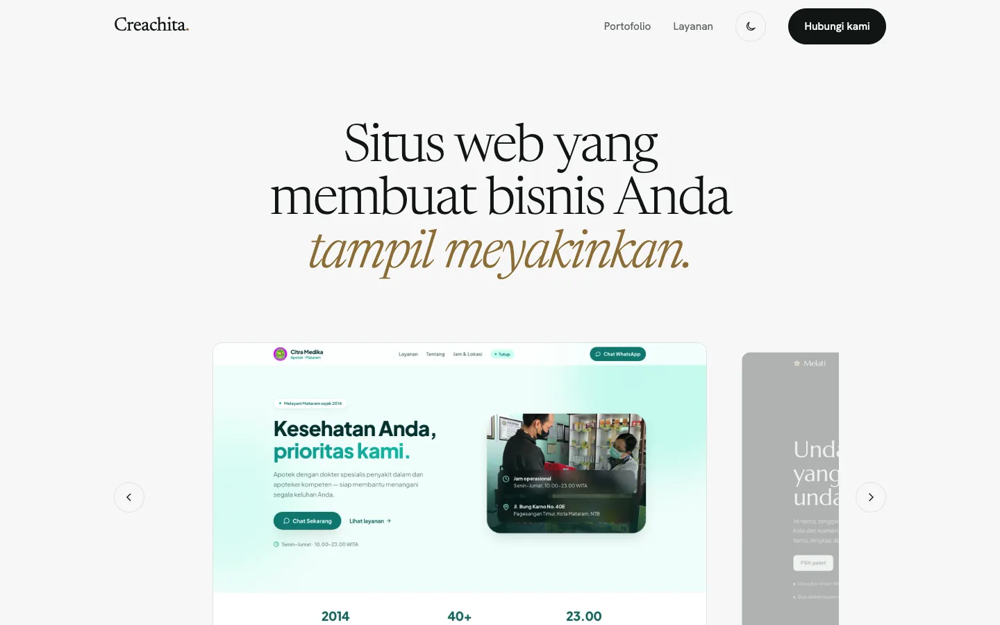
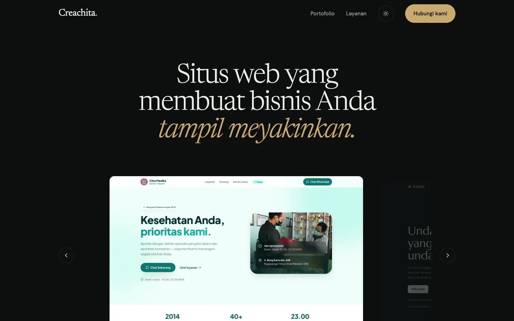

# Creachita

Landing page for [creachita.com](https://www.creachita.com) — studio desain & pengembangan web.

Live: https://creachita-studios.vercel.app



| Dark mode | Mobile |
|---|---|
|  |  |

## Stack

One static `index.html` — no build step, no dependencies.

- Fonts: Newsreader + Hanken Grotesk (Google Fonts)
- Portfolio slider: native CSS scroll-snap, swipe on touch, arrows, keyboard, and project names
- Light / dark mode follows the system, with a toggle saved in `localStorage`
- Project screenshots live in `shots/`

## Portfolio

Order in the slider is the order of the `P` array in `index.html`.

| Project | URL |
|---|---|
| Citra Medika | https://www.citramedika.net |
| Melati | https://webinv-six.vercel.app |
| SIGAP Pegadaian | https://sigap-pegadaian.vercel.app |
| Gold Insight | https://goldins.vercel.app |
| Makan Angin | https://makanangin.vercel.app |
| Sealed | https://giftygen.vercel.app |
| ImUpScaller | https://image-upscaller.vercel.app |
| Blockchain demo | https://blockchain-demo-theta.vercel.app |

To add a project: put a 16:10 screenshot in `shots/<name>.webp` and add a row to `P`.

## Run locally

```bash
python3 -m http.server 4321
```

## Deploy

Pushing to `main` deploys to Vercel (project `creachita-studios`).
